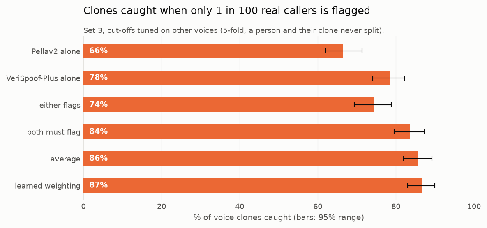
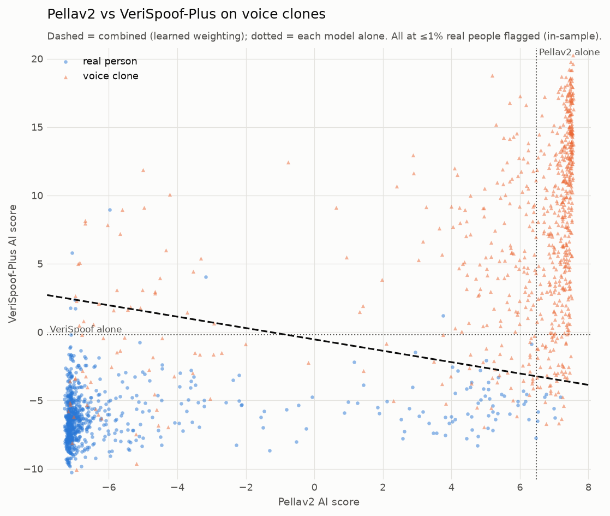
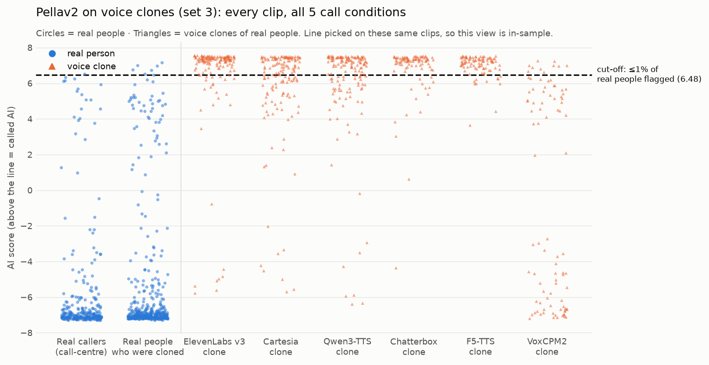
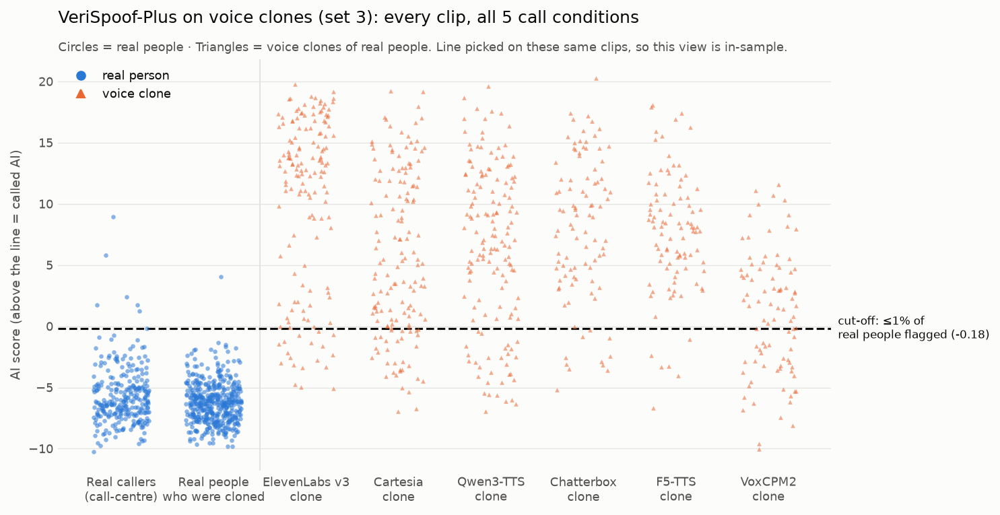
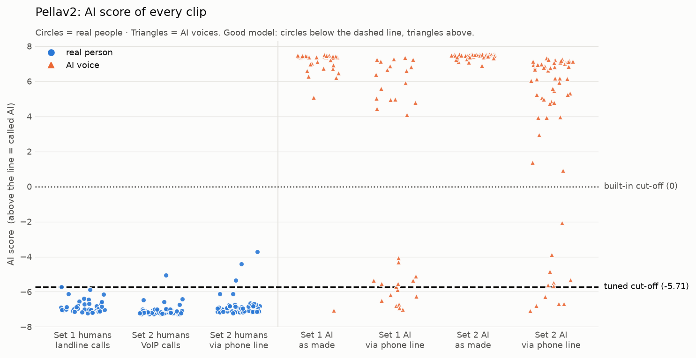
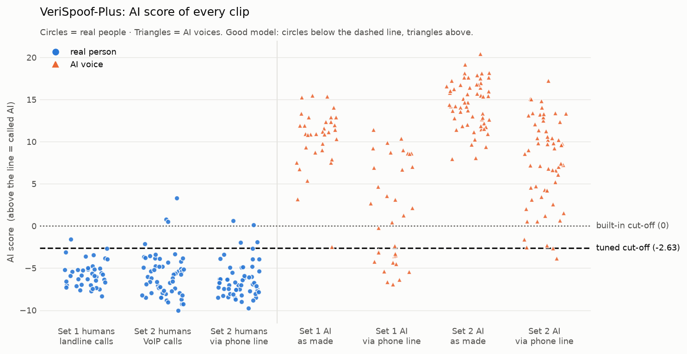
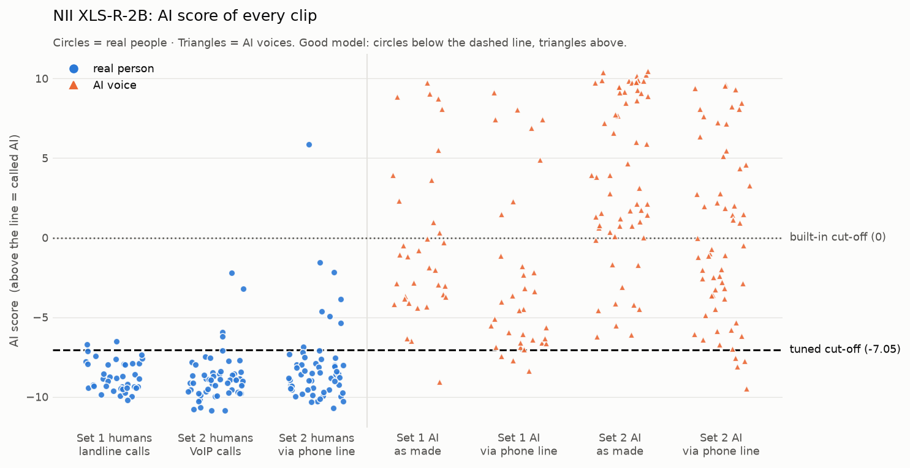
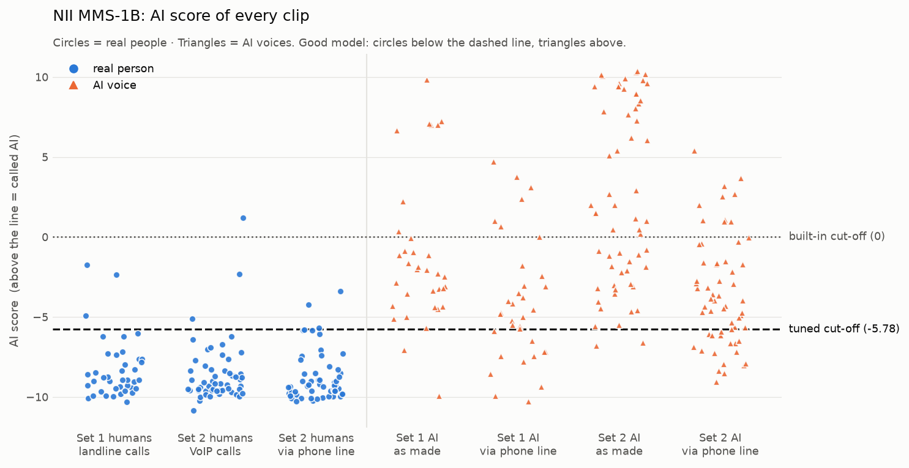

# Can free models tell an AI voice from a real person on a call?

**Use case:** a card issuer's customer-service line. Some callers hand the call to an AI agent that speaks in a **clone of the caller's own voice**. The question is whether open models can tell the clone from the real person on the line.

**What I tested, in three rounds:**
- **Broad round:** 9 free detectors (10 models, because ProSDD comes in two versions) on 340 clips of ordinary AI voices versus real callers.
- **Hard round:** the two best detectors, **Pellav2** and **VeriSpoof-Plus**, plus four ways of combining them, on **1,460 clips of voice clones versus the real people who were cloned**. Every clip was heard in 5 call conditions.

## Bottom line for voice-clone calls

| If you… | Use | Clones caught | Real callers wrongly flagged |
|---|---|---|---|
| can tune on your own call audio, and may use non-commercial models | **Pellav2 + VeriSpoof-Plus combined** (average of their probabilities, or a learned weighting) | **86–87%** | **1 in 100** |
| …and can accept more flags | same combination | **91–94%** | 5 in 100 |
| can't tune, and just switch it on | **average** of the two at its built-in 50/50 point | **90%** | 4 in 100 |
| need a **commercial** licence | **Pellav2 alone**, tuned on your own calls | 85% / 66% | 5 / 1 in 100 |

- **How these were measured:** cut-offs were tuned on *other people's* voices and graded on held-out people, with a person and their clone always kept together. The 95% ranges are in [the hard test](#hard-test-voice-clones-of-real-callers) below.
- **The ranges in the table:** "86–87%" spans the average and the learned weighting. In the last row, "85% / 66%" is clones caught at 5 in 100 / 1 in 100 callers flagged.
- **Licences decide a lot here.** VeriSpoof-Plus is licensed for **non-commercial use only** (CC BY-NC 4.0). Using it in a bank's production system would need permission from its authors. Pellav2 is MIT-licensed, so commercial use is fine, but it's clearly weaker on clones.
- **Hardest to catch: the newest open-source cloner, VoxCPM2.** Even the best combination caught only about half of its clones at 1 in 100 flagged. Mobile-phone audio and background chatter also cost the combinations 14–26 points compared with clean audio.
- **Calling a clip AI if *either* model flags it doesn't help.** That rule caught 74% at 1 in 100 flagged, fewer than VeriSpoof alone (78%). It looked promising in round 1, but proper testing showed it isn't.
- **Possible problem for real callers whose audio is AI-cleaned.** Real voices that had been "restored" by an AI audio-cleanup model were flagged far more often (Pellav2 passed 17% of them, versus 75% of the untouched originals). Phones and calling apps with AI noise suppression might cause the same false alarms. Test this on your own callers before rolling anything out.

## Hard test: voice clones of real callers

### What's in it: 146 real people and a clone of each, in 5 call conditions (1,460 clips)

| Real people | Their clones |
|---|---|
| **90 people reading sentences**: the original recordings from [FLEURS](https://huggingface.co/datasets/google/fleurs) | Commercial clones made from these same people by **ElevenLabs v3** (instant clone), **Cartesia sonic** and **Qwen3-TTS** (30 each), from [this comparison dataset](https://huggingface.co/datasets/jaeyong2/cartesia-sonic-preview-ztts1-zero-shot). The source dataset rates their voice match at 0.94–0.97 out of 1. |
| **56 real callers** from role-played customer-service calls ([AppTek](https://huggingface.co/datasets/apptek-com/apptek_callcenter_dialogues), 14 English accents, none used in round 1) | Clones made here with three open-source cloning tools: **Chatterbox** (19), **F5-TTS** (19) and **VoxCPM2** (18). Each was cloned from 10 seconds of the **caller's own call audio**, taken from the other half of the call than the test clip. Each clone says a customer-service line ("I think my card was stolen…", "Sure, my date of birth is…"). Whisper transcription confirmed every clone says its line (93–96% of words matched). |

Every clip, real or clone, was then put through 5 call conditions:
- **as recorded**
- **landline** (G.711)
- **mobile** (the AMR-NB codec mobile networks use)
- **internet call** (the Opus codec at 12 kbps, as used by WhatsApp and Teams)
- **mobile with background chatter** (other people talking, 12 dB quieter than the caller)

**One correction made along the way.** The commercial clones were made from "restored" FLEURS-R recordings, which an AI audio-cleanup model had regenerated, so they aren't untouched human audio. I replaced them with the **original** FLEURS recording of the same person and sentence. Each original was found by lining up its spectrogram with the restored version: typical match 0.89, versus 0.37 for other readers of the same sentence. The restored recordings are kept only for the side finding at the end of this section.

### How the combination was graded

**The six options tested:**
- Pellav2 alone
- VeriSpoof-Plus alone
- **either flags** (AI if either model says AI)
- **both must flag**
- **average** of their probabilities, using each model's own conversion to a probability (VeriSpoof's is published on its model card)
- **learned weighting** (a small model fitted on the two scores)

**Two ways to tune and grade them:**
- **Protocol 1, "switch it on":** tune on the easier rounds (sets 1 and 2), then face the clones.
- **Protocol 2, "tune on your own calls":** five-fold cross-validation inside the clone set. A person and their clone are always in the same fold, so no voice is ever tuned on and graded on.

**Cut-offs** are set so that at most 5% or 1% of the *tuning* set's real people would be flagged. **Ranges** are 95% bootstrap ranges that resample whole people.

### Results, protocol 2 (tuned on other voices, graded on held-out voices)

| Option | Clones caught, ≤5% flagged | Real people passed | Clones caught, ≤1% flagged | Real people passed |
|---|---|---|---|---|
| Pellav2 alone | 85% (80–89) | 95% | 66% (62–71) | 99% |
| VeriSpoof-Plus alone | 89% (85–92) | 95% | 78% (74–82) | 99% |
| either flags | 88% (84–91) | 95% | 74% (69–79) | 99% |
| both must flag | 92% (89–94) | 95% | 84% (80–87) | 99% |
| **average** | 91% (88–94) | 95% | **86% (82–89)** | 99% |
| **learned weighting** | **94% (92–96)** | 95% | **87% (83–90)** | 99% |



### Results, protocol 1 (tuned on the easier rounds, never saw a clone)

| Option, cut-off | Clones caught | Real people passed |
|---|---|---|
| Pellav2, built-in | 90% | 90% |
| Pellav2, "≤5% flagged" from easier rounds | 96% | **77%**: the cut-off doesn't carry over |
| VeriSpoof-Plus, built-in | 81% | 99% |
| VeriSpoof-Plus, "≤5% flagged" from easier rounds | 87% | 97% |
| **average, built-in 50/50 point** | **90%** | **96%** |
| learned weighting, built-in | 96% | 83% |

**What this shows:** a cut-off tuned on ordinary AI voices doesn't hold for clones. Pellav2 flags many more real people in these call conditions than it did in the easier rounds. VeriSpoof-Plus, and the plain average of the two at 50/50, held up best without any tuning.

### Why combining helps



**Reading the chart:**
- **Real people** (blue) sit low on both scores, bottom-left.
- **Clones Pellav2 misses** sit along the left edge, but often score high on VeriSpoof.
- **Clones VeriSpoof misses** sit along the bottom, but often score high on Pellav2.

The dashed line combines the two scores and separates the groups better than either dotted line (each model alone). All lines here are drawn on the same clips they separate, so this chart is illustrative; the measured results are the tables above.




### Where clones get through (protocol 2, ≤1% of real people flagged)

| Clone source | Pellav2 | VeriSpoof-Plus | average | learned weighting |
|---|---|---|---|---|
| F5-TTS | 92% | 94% | 98% | 96% |
| Chatterbox | 85% | 88% | 96% | 96% |
| ElevenLabs v3 | 83% | 84% | 93% | 93% |
| Cartesia sonic | 58% | 73% | 87% | 89% |
| Qwen3-TTS | 63% | 77% | 87% | 86% |
| **VoxCPM2** | **12%** | 52% | 47% | 56% |

| Call condition | Pellav2 | VeriSpoof-Plus | average | learned weighting |
|---|---|---|---|---|
| as recorded | 91% | 99% | 95% | 99% |
| internet call (Opus) | 82% | 77% | 89% | 91% |
| landline | 39% | 87% | 88% | 92% |
| mobile (AMR-NB) | 53% | 70% | 76% | 78% |
| mobile + background chatter | 66% | 58% | 81% | 73% |

**Real people passed** at this setting: 94–100% in every condition. Background chatter was lowest for every option: Pellav2 94%, VeriSpoof 98%, average 96%.

**Small groups move in big steps:** each clone tool has 18–30 people and each condition has 146 people per side, so one person shifts a tool's figure by 3–6 points.

### Side finding: AI-cleaned human audio gets flagged

These are the same people and sentences. The only difference is whether the audio had been regenerated by an AI audio-cleanup model.

| Option (protocol 1, ≤5% cut-off) | Original recordings passed as human | AI-restored recordings passed as human |
|---|---|---|
| Pellav2 alone | 75% | **17%** |
| VeriSpoof-Plus alone | 98% | **56%** |
| average | 86% | 26% |

**Why this matters for a call centre:** it's a real risk of false alarms. A genuine caller whose phone or app runs AI noise suppression might be flagged. This test used one restoration model (FLEURS-R's), not real noise-suppression apps, so it shows the risk without measuring its size.

### Limits of the hard test

- **Simulated conditions:** the call conditions are produced with real codecs, but not over a real network.
- **Read speech:** the 90 FLEURS people read sentences, so they aren't on a call. The 56 AppTek callers are on role-played calls.
- **Old-style cloners only:** clones are made from 10 s of audio and say short lines. Agents that respond in real time, or newer cloners than VoxCPM2, weren't tested.
- **Training data unknown:** Pellav2's training data is private, and VeriSpoof-Plus lists only some of its training sets. Either may have seen some of these cloning tools during training.
- **One voice per tool:** each voice was cloned by one tool, so the per-tool comparison isn't on identical voices.

## Broad test: recommendation (sets 1 and 2, ordinary AI voices)

| | Model | Use it when | Cut-off to use |
|---|---|---|---|
| **1** | **[Pellav2](https://huggingface.co/Sadanie/pellav2-audio-deepfake-detector)** | You need **commercial use** (MIT licence), speed, and **almost no real callers wrongly flagged**. | Built-in (0): flagged **no** real callers in either set. Use -5.7 to catch more AI, at the cost of flagging about 1 in 20 real callers. |
| **2** | **[VeriSpoof-Plus](https://huggingface.co/AustinXiao/VeriSpoof-Plus)** | **Non-commercial** use, where you want the best overall accuracy plus a written reason for each decision. | Built-in (0). Tuning didn't help, see below. |
| 3 | [NII XLS-R 2B](https://huggingface.co/nii-yamagishilab/xls-r-2b-anti-deepfake) | Non-commercial use, and AI voices over **phone lines** are your main worry. | **Must** use about **-7**. At the built-in 0 it lets most AI through. |
| 4 | [NII MMS 1B](https://huggingface.co/nii-yamagishilab/mms-1b-anti-deepfake) | A smaller backup for #3. | About -6. |

**Not recommended:** AASIST, W2V2-AASIST, SONAR, ProSDD (both versions), wav2vec2-XLSR. On these calls they did no better than a coin flip, and most did worse. They were trained mainly on the 2019 ASVspoof benchmark, a collection of studio-quality recordings, and they mistake ordinary call audio for AI.

**The one big weakness every model shares:** an AI voice sent through a phone line is much harder to catch. On set 1, ElevenLabs v4 voices went from 95% caught (Pellav2) to 60% once sent through a phone line. VeriSpoof-Plus fell from 100% to 35%. If you're screening phone calls, test on audio from your own phone system before trusting any of these numbers.

## The two test sets

| | Real people | AI voices |
|---|---|---|
| **Set 1** (108 clips) | 40 clips from [CallHome](https://huggingface.co/datasets/BrunoHays/callhome-telephony): real family phone calls on 1990s landlines. | 34 clips: ElevenLabs v4 (20), ElevenLabs multilingual v2 (6), and Microsoft Edge voices reading phone-agent lines I wrote (8). Each AI clip also has a phone-line copy, 68 AI clips in all. |
| **Set 2** (232 clips) | 56 clips from [AppTek call-centre dialogues](https://huggingface.co/datasets/apptek-com/apptek_callcenter_dialogues): real people in role-played customer-service calls over an internet calling platform, 4 speakers from each of 14 English accents. Each also has a phone-line copy, 112 human clips in all. | 60 clips from [this comparison dataset](https://huggingface.co/datasets/jaeyong2/cartesia-sonic-preview-ztts1-zero-shot), 15 each from Cartesia sonic, OpenAI gpt-4o-mini-tts, ElevenLabs v3 and Qwen3-TTS. Each also has a phone-line copy, 120 AI clips in all. |

- **Clip length:** each clip is the loudest 6 seconds of a recording, which is mostly speech. A few set-2 AI clips are shorter (4.2 s minimum) because the whole recording was shorter.
- **The phone line is simulated:** 8 kHz audio, only the 300–3400 Hz voice band kept, and the 8-bit compression landlines use. It is not a real call.
- **Why simulate it:** without phone-line copies of the AI clips, a model could score well just by learning that "phone audio = human".
- **No overlap between sets:** neither set shares a source with the other.
- **Training data is only partly checkable.** NII publishes its training list, and none of these sources is on it (one partial exception is noted under "Limits"). VeriSpoof-Plus names only some of its training sets, and Pellav2's training data is private. Either could have trained on ElevenLabs or similar voices, which would flatter their scores.

## How the cut-off was tuned (and graded fairly)

Each model gives every clip a score: above the cut-off means "AI", below means "human". Models come with a built-in cut-off of 0. Some models rank AI clips and humans well but put the line in the wrong place.

**The method:** I picked each model's cut-off using **one set only**, then graded it on the **other set**, in both directions. So these figures are never graded on the clips they were tuned on.

**The score used below** is the average of "% of AI caught" and "% of real people passed". This keeps the larger set from dominating.

| Model | Graded on set 2, built-in cut-off | Graded on set 2, cut-off tuned on set 1 | Graded on set 1, built-in cut-off | Graded on set 1, cut-off tuned on set 2 |
|---|---|---|---|---|
| Pellav2 | 95% | 96% | 88% | 92% |
| VeriSpoof-Plus | 96% | 96% | 88% | 88% |
| NII XLS-R 2B | 81% | **93%** | 64% | **92%** |
| NII MMS 1B | 69% | 88% | 60% | 84% |
| wav2vec2-XLSR | 66% | 55% | 44% | 47% |
| ProSDD (2024 version) | 52% | 54% | 51% | 53% |
| W2V2-AASIST | 52% | 50% | 43% | 39% |
| SONAR | 40% | 48% | 36% | 49% |
| AASIST | 41% | 48% | 41% | 46% |
| ProSDD (2019 version) | 33% | 50% | 24% | 50% |

50% is what a coin flip scores. Behind those averages, for the top four:

| Model, cut-off | Set 2: AI caught | Set 2: humans passed | Set 1: AI caught | Set 1: humans passed |
|---|---|---|---|---|
| Pellav2, built-in 0 | 90% | **100%** | 75% | **100%** |
| Pellav2, tuned on the other set (-5.7 / -5.9) | 96% | 96% | 88% | 95% |
| VeriSpoof-Plus, built-in 0 | 96% | 96% | 76% | 100% |
| NII XLS-R 2B, tuned on the other set (-7.1 / -6.8) | 97% | 88% | 90% | 95% |
| NII MMS 1B, tuned on the other set (-5.9 / -6.9) | 85% | 92% | 84% | 85% |

**VeriSpoof-Plus's best cut-off doesn't carry over between sets.** Picked on set 2 it lands at +0.54, and on set 1 that catches fewer AI clips (75%) than the built-in 0 does. So keep its built-in cut-off.

**Pellav2's tuned cut-off is stable** (-5.7 to -5.9 whichever set it's picked on). But the scatterplot below shows the trade-off: it sits just above the real people. That's why each extra AI clip it catches comes with some real callers wrongly flagged.

Cut-offs picked on **both sets together**, for anyone deploying, are in [results/recommended_cutoffs.csv](results/recommended_cutoffs.csv). Those are tuned on all 340 clips, so their in-sample accuracy will look slightly better than the numbers above.

## Scatterplots for the recommended models

Each dot is one clip. Circles are real people, triangles are AI. A good model puts circles below the dashed line and triangles above it.

- **Dashed line:** the cut-off tuned on both sets together.
- **Dotted line:** the model's built-in cut-off.
- **Scale:** each model scores on its own scale, so compare positions within a chart, not across charts.



**Pellav2.** The real people sit tightly together. Almost all AI clips get high scores. The ones it misses mostly score as low as real people, so moving the line can't rescue those.





**NII XLS-R 2B.** Most AI clips score below the built-in line at 0, yet still well above the real people. That's why a tuned cut-off near -7 takes it from 64–81% to over 90%.



## What each model missed

Share of clips judged correctly, using the cut-off tuned on both sets together. These rates are **in-sample**, so read them for which sources are hard, not as accuracy figures. Small groups move in big steps: one clip is 25% of a 4-speaker accent group, 7% of a 15-clip engine group, and 5% of a 20-clip group.

| Source | Pellav2 | VeriSpoof-Plus | NII XLS-R 2B | NII MMS 1B |
|---|---|---|---|---|
| ElevenLabs v4 via phone line (set 1, 20 clips) | 60% | 35% | **85%** | 60% |
| Qwen3-TTS via phone line (set 2, 15 clips) | 67% | **93%** | 87% | 53% |
| Cartesia via phone line (set 2, 15 clips) | 100% | 100% | 87% | 47% |
| All other AI sources | 95–100% | 100% | 95–100% | 50–100% |
| Real callers, CallHome landline (40) | 100% | 98% | 95% | 92% |
| Real callers, AppTek, 14 accents (56 + 56 phone-line copies) | 75–100% per accent | 50–100% per accent | 50–100% per accent | 75–100% per accent |

**Accent results are too thin to judge.** For each model, a few accents dropped to 50–75% (Singapore, Chinese, Welsh and Canadian English). But with 4 speakers per accent I can't tell real accent bias from chance.

## Combining Pellav2 and VeriSpoof-Plus

An early quick check of "either model flags" looked promising on sets 1 and 2. Properly tested on voice clones, it wasn't better than VeriSpoof alone. The combinations that do help (average and learned weighting) are in [the hard test](#hard-test-voice-clones-of-real-callers).

## How I checked the setup is right

The [Speech Anti-Spoofing Arena](https://huggingface.co/SpeechAntiSpoofingBenchmarks) publishes each model's score for every clip of its test datasets. I ran 8 of the models through my setup on 24 of those same clips, from the In-the-Wild dataset, and compared ranking orders. 1.0 means the identical order.

- **Six models matched almost exactly** (0.99–1.00).
- **The two NII models matched less closely** (0.83 and 0.92). My NII setup follows NII's own evaluation code line by line, so the difference is in how the Arena ran them.
- **The other two models couldn't be checked this way:** the Arena publishes no scores for wav2vec2-XLSR or VeriSpoof-Plus.

Full figures: [results/parity_check.csv](results/parity_check.csv).

**Bridge for older models.** SONAR, W2V2-AASIST and both NII models were built with an older library (fairseq) that no longer installs. `vad_bench/w2v2_bridge.py` loads their weights into the current standard version of the same network. A unit test confirms the loaded network gives identical output to the original.

**VeriSpoof-Plus on a Mac.** It is written for NVIDIA graphics cards. Here it runs at full precision on a Mac instead, with its maths unchanged.

## Model details

| Model | Size | Time per 6 s clip (M3 Pro) | Licence | Weights |
|---|---|---|---|---|
| Pellav2 | ~0.6 B | ~0.1 s | MIT | [Hugging Face](https://huggingface.co/Sadanie/pellav2-audio-deepfake-detector) ([Arena copy](https://huggingface.co/SpeechAntiSpoofingBenchmarks/Pellav2) used here) |
| VeriSpoof-Plus | 2.9 B | ~0.7 s | CC BY-NC 4.0 (non-commercial) | [Hugging Face](https://huggingface.co/AustinXiao/VeriSpoof-Plus) |
| NII XLS-R 2B | 2 B | ~0.4 s | CC BY-NC-SA 4.0 (non-commercial) | [Hugging Face](https://huggingface.co/nii-yamagishilab/xls-r-2b-anti-deepfake) |
| NII MMS 1B | 1 B | ~0.2 s | CC BY-NC-SA 4.0 (non-commercial) | [Hugging Face](https://huggingface.co/nii-yamagishilab/mms-1b-anti-deepfake) |
| wav2vec2-XLSR | 0.3 B | ~0.1 s | Apache 2.0 | [Hugging Face](https://huggingface.co/Gustking/wav2vec2-large-xlsr-deepfake-audio-classification) |
| SONAR | 0.6 B | ~0.1 s | CC BY-NC 4.0 | [Hugging Face](https://huggingface.co/SpeechAntiSpoofingBenchmarks/SONAR-Full) |
| W2V2-AASIST | 0.3 B | <0.1 s | MIT | [Hugging Face](https://huggingface.co/SpeechAntiSpoofingBenchmarks/W2V2-AASIST), [code](https://github.com/TakHemlata/SSL_Anti-spoofing) |
| ProSDD (2019 and 2024 versions) | 0.3 B | <0.1 s | none given | [code and weights](https://github.com/ProSDD/codes) |
| AASIST | 0.3 M | <0.1 s | MIT | [code and weights](https://github.com/clovaai/aasist) |

Times are the average over 232 clips on an Apple M3 Pro's built-in graphics chip, after the model has loaded.

## Limits of this test

- **The groups are small.** Per set, at least 40 real-person clips and 34 AI clips. One clip shifts a percentage by 1–3 points, so gaps of a few points between models are noise.
- **The phone line is simulated,** not a real call. Real networks, mobile codecs and speakerphones may behave differently.
- **Set-2 humans are role-played calls,** not live customer calls. They are real people speaking, though.
- **The AI voices are mostly clean read speech.** Voice agents that add background noise, or real-time cloned voices, weren't tested.
- **Some set-2 AI clips may resemble NII's training data.** Two set-2 engines (Cartesia, ElevenLabs v3) cloned speakers from the FLEURS recordings. NII trained on FLEURS's real recordings, though not on these AI clips.

## Reproduce

```bash
uv venv --python 3.11 .venv && uv pip install --python .venv/bin/python -r requirements.txt
./scripts/download_models.sh              # about 30 GB of model weights
.venv/bin/python scripts/prepare_data.py    # set 1 clips
.venv/bin/python scripts/prepare_data_b.py  # set 2 clips
.venv/bin/python scripts/run_all.py && .venv/bin/python scripts/run_all.py --set b
.venv/bin/python scripts/report.py && .venv/bin/python scripts/analyze.py
.venv/bin/python scripts/plot.py "Pellav2" "VeriSpoof-Plus" "NII XLS-R-2B" "NII MMS-1B"
.venv/bin/python scripts/parity_check.py    # optional: compare against Arena's published scores

# hard test (voice clones)
.venv/bin/python scripts/prepare_data_c.py   # real voices, commercial clones, clone jobs
for e in chatterbox f5 voxcpm; do            # each cloning tool in its own environment
  uv venv --python 3.11 cloners/.venv-$e
done
uv pip install --python cloners/.venv-chatterbox/bin/python chatterbox-tts "setuptools<81"
uv pip install --python cloners/.venv-f5/bin/python f5-tts
uv pip install --python cloners/.venv-voxcpm/bin/python voxcpm
for e in chatterbox f5 voxcpm; do cloners/.venv-$e/bin/python cloners/clone.py $e; done
.venv/bin/python scripts/build_set_c.py      # 5 call conditions
.venv/bin/python scripts/fleurs_originals.py # swap restored recordings for the originals
.venv/bin/python scripts/run_all.py --set c --only Pellav2 VeriSpoof-Plus
.venv/bin/python scripts/run_all.py --set c-orig --only Pellav2 VeriSpoof-Plus
.venv/bin/python scripts/analyze_combo.py && .venv/bin/python scripts/plot_combo.py

.venv/bin/python -m pytest -q tests          # 95 tests
```

The audio isn't in this repo, because of its source licences, and the cloned voices are deliberately not published. The manifests in `data/clips*/manifest.csv` list every clip, and the `prepare_data` scripts rebuild them.

| Folder or file | What's in it |
|---|---|
| `vad_bench/` | Shared code: audio handling, phone-line simulation, scoring maths, cut-off tuning, one runner per model. |
| `scripts/` | Download, build test sets, score, report, plot. |
| `results/scores.csv`, `results/scores_b.csv` | Every model's score for every clip. |
| `results/cross_set.csv` | The tune-on-one-set, grade-on-the-other results. |
| `results/scores_c*.csv`, `results/combo_*.csv` | Hard-test scores, and the combination results for both protocols. |
| `cloners/clone.py` | Makes the open-source voice clones. |
| `vad_bench/channels.py`, `vad_bench/combo.py` | Call conditions, the combination options, and the grading code. |

## Data licences

- **CallHome:** CC BY-NC-SA 4.0 (TalkBank).
- **AppTek call-centre dialogues:** CC BY-SA 4.0.
- **ElevenLabs v4 dataset:** CC BY 4.0 (LAION).
- **ElevenLabs multilingual v2 dataset:** Apache 2.0.
- **ZTTS1-Eval derived dataset:** see its card.
- **Microsoft Edge clips:** generated for this test with edge-tts.
